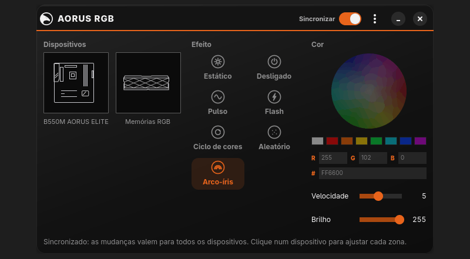
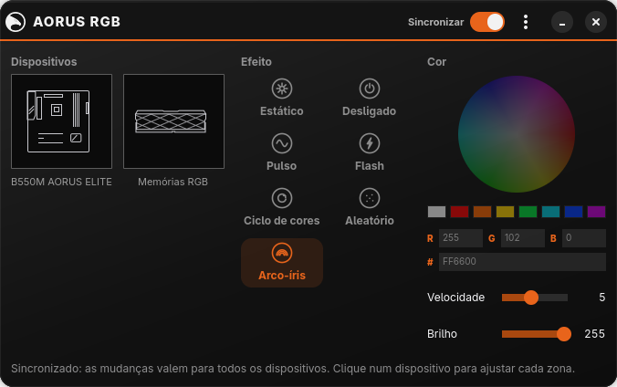
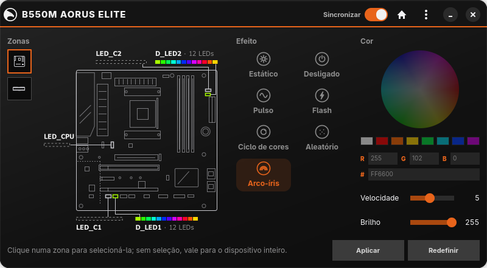
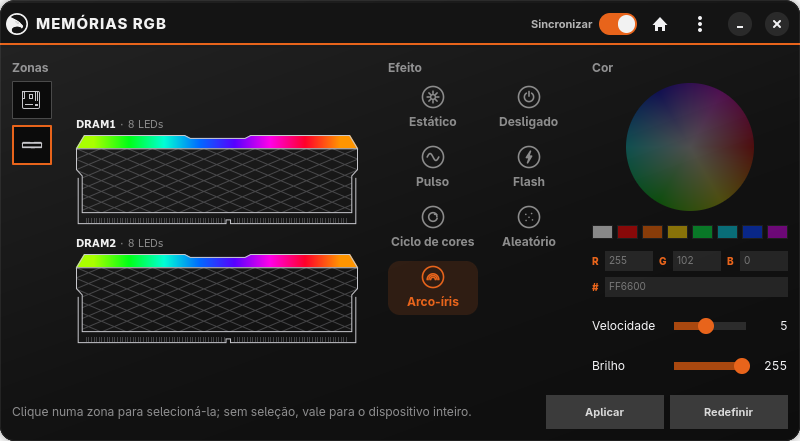
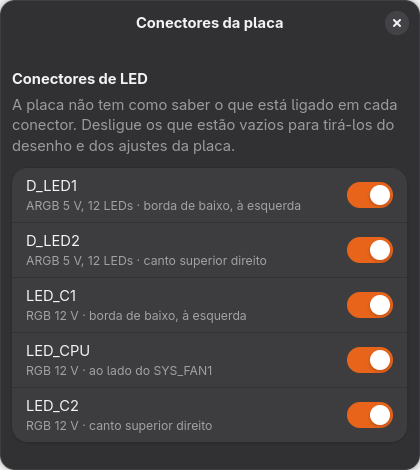

# Interface gráfica

A partir da 2.0, o pacote `aorus-rgb-gui` traz o **AORUS RGB**, uma interface
GTK 4 / libadwaita no arranjo do RGB Fusion 2.0. Ela não fala com o hardware:
pede tudo ao [daemon](daemon.md) pelo D-Bus, então a CLI e a interface podem
ser usadas ao mesmo tempo e sempre mostram o mesmo estado.

## Telas

**Início.** Os dispositivos, os efeitos e a cor. Com **Sincronizar** ligado
(cabeçalho), o efeito escolhido vale para a placa e as memórias juntas, e os
efeitos animados (pulso, flash, ciclo, aleatório e arco-íris) andam em fase nos
dois. Desligado, os controles do início ficam inativos e cada dispositivo é
ajustado na própria tela.

**Placa.** O desenho segue o leiaute do manual da B550M AORUS ELITE: cada
conector de LED aparece na posição real, ligado à barra da zona. Clique numa
barra (ou no conector) para selecionar a zona; vários cliques somam zonas, e
sem seleção o ajuste vale para a placa inteira. Mexer numa zona desliga a
sincronização, porque os dispositivos deixam de ter o mesmo efeito.
**Aplicar** fixa o estado atual como ponto de partida e **Redefinir** volta as
zonas a ele. O daemon já guarda a cena sozinho e a restaura no próximo login.

**Memórias.** Um pente por memória RGB detectada, com a barra de luz no topo.
Os pentes aparecem sozinhos: o controlador ENE de cada um responde no SMBus.

## Conectores sem nada ligado

A placa não tem como saber o que está ligado em cada conector: os de 12 V só
alimentam os LEDs e os ARGB mandam dados num sentido só. Em **Menu → Conectores
da placa**, desligue os que estão vazios; eles saem do desenho (fica só o
conector) e dos ajustes da placa.

As preferências da interface (sincronização e conectores vazios) ficam em
`~/.config/aorus-rgb/gui.ini`. A cena dos LEDs é do daemon, em `config.json`.

## Instalação

    sudo pacman -U aorus-rgb-2.0.0-1-any.pkg.tar.zst aorus-rgb-gui-2.0.0-1-x86_64.pkg.tar.zst
    systemctl --user enable --now aorus-rgb

O app aparece no menu como **AORUS RGB** (`aorus-rgb-gui` no terminal). Se o
daemon não estiver rodando, a janela mostra um aviso com o comando para
iniciá-lo.

## Desenvolvimento

O código está em `feat/gui` (e em `gui/` na `release/2.0.0`), em Rust com
gtk4-rs e libadwaita-rs. O build fica fora do repositório:

    CARGO_TARGET_DIR=~/.cache/aorus-rgb/target cargo build
    ~/.cache/aorus-rgb/target/debug/aorus-rgb-gui --mock

| Opção | Para quê |
|-------|----------|
| `--mock` | hardware simulado, sem daemon, para validar a interface |
| `--page home\|board\|memory` | tela inicial |
| `--dialog connectors\|about` | abre um diálogo ao iniciar |
| `--screenshot ARQ.png` | salva a janela (e um diálogo aberto, em `ARQ-2.png`) e fecha |
| `--record PASTA` | percorre a interface num roteiro fixo e salva quadros PNG |

As imagens desta página saíram de `--mock --screenshot` e o GIF, de
`--mock --record`. Com o daemon rodando, `cargo test -- --ignored` aplica cada
efeito pelo mesmo caminho da interface e confere o estado relido.
